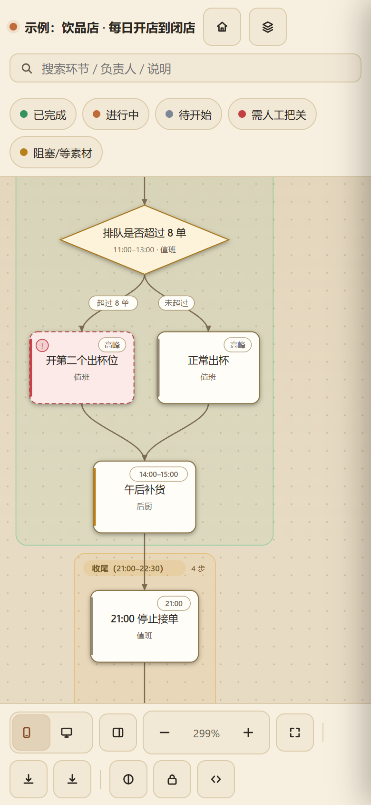
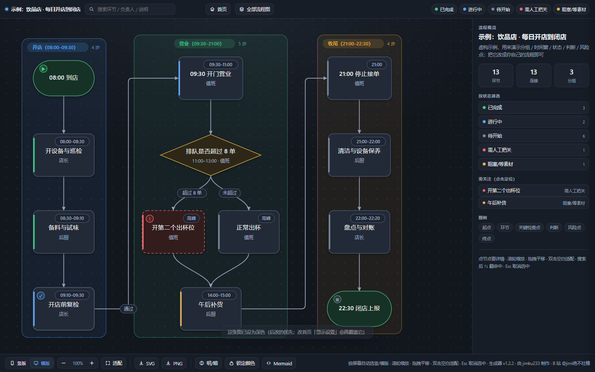

# workflow-visualizer

把**业务流程**变成能点、能搜、能导出的**交互式流程图**：一个 HTML 文件搞定，零依赖、纯离线（不请求任何 CDN、不联网），同时产出可以粘进飞书 / 语雀 / GitHub / Typora 的 **Mermaid 源码**。

本仓库根目录**就是** [Agent Skill](https://code.claude.com/docs/en/skills) 目录（`SKILL.md` 在根上），`git clone` 到技能发现路径即可用。

想先看效果：直接双击 [`docs/demo.html`](docs/demo.html)（用 `examples/` 里的中性示例渲染出来的完整产物，单文件、离线可开）。




## 三件最重要的事

1. **看图**：打开卡片/HTML → **点任意环节**看时间 / 负责人 / 说明；底部工具栏切 **竖版 / 横版**、切明暗、导出 **SVG / PNG**。
2. **搜索**：搜环节名 / 负责人 / 说明，清单里 **蓝边**＝标题命中、**黄色点线**＝只在说明里命中；**↑ ↓** 或 **Enter** 连着翻，**Esc** 清空。键盘还能 **Tab** 停在环节上、**Enter** 打开详情。
3. **更新**：产物是**自包含快照，不会自动更新** —— 改了流程要重新渲染；首页会把旧版渲染的文件标成怎旧版渲染」，跑 `node scripts/flow.mjs refresh <目录>` 一次全刷。

> 新装的技能想生效：**新开一个会话/对话**（技能目录是启动时扫描的）。首页右上角「如何使用」按钮里有同样的说明。
## 特性

同一份规格会渲染**两版**，页面按窗口比例自动选、底部可手动切：

| 版式 | 用途 |
|---|---|
| 竖版 portrait | 单列纵向，手机上一行一个环节，细节完整 |
| 横版 landscape | 长流程自动分栏（可指定每栏行数），电脑一屏看完 |

- 节点可点开看怎时间 / 负责人 / 说明 / 备注」，并高亮上下游、其余淡出
- 搜索框搜环节、负责人、说明；**↑ ↓ / Enter 连续翻命中**，非命中整体淡出
- 按状态筛选（已完成 / 进行中 / 需人工把关 / 待开始 / 阻塞等素材）
- 明 / 暗主题（跟随系统，可锁定）；缩放到看不清小字时自动怎简化」并加深对比度
- 导出当前版式的 **SVG / PNG**，随时复制 **Mermaid** 源码
- 右侧怎全部流程图」抽屉在多个流程之间切换；手机端单指拖动、双指缩放
- 分组带（阶段/班次）自动成带，标题与计数居中；起点/终点用胶囊，判断用菱形，风险点虚线
- **键盘可用**：`Tab` 停在每个环节上、`Enter`/空格 打开详情；抽屉是标准对话框（`Esc` 关闭并回到触发按钮）
- **可读性有硬指标**：深浅两套主题的文字对比度都由脚本按 WCAG 复算（小字 ≥4.5:1，非文本 ≥3:1）

## 安装

### 装成 Agent 技能（推荐）

技能发现规则是怎发现根下面**一层**目录里有 `SKILL.md`」。因此**本仓库根目录就是技能目录**：

```bash
# 用户级（所有项目可用）
git clone <本仓库地址> ~/.dsh/skills/workflow-visualizer          # DSH
git clone <本仓库地址> ~/.claude/skills/workflow-visualizer        # Claude Code 等认 SKILL.md 的 agent

# 或只给某个项目用
git clone <本仓库地址> <你的项目>/.dsh/skills/workflow-visualizer

# 更新
cd ~/.dsh/skills/workflow-visualizer && git pull
```

Windows（PowerShell）：

```powershell
git clone <本仓库地址> "$env:USERPROFILE\.dsh\skills\workflow-visualizer"
```

不想搬家，也可以把仓库的**父目录**登记进 DSH 配置：

```jsonc
{
  "skills": {
    "filesystem": {
      "customSkillDirs": ["/绝对路径/到/仓库的父目录"]
    }
  }
}
```

装好后在会话里说怎把这些流程画成图」，或用 `/workflow-visualizer` 直接调用。

> 注意：不要把仓库 clone 成 `~/.dsh/skills/<仓库名>/` 之后再套一层 `skills/` —— 技能发现只认**一层**，多一层就找不到。仓库根必须直接是 `SKILL.md` 所在目录。

### 适配哪些 agent

| 情况 | 能做什么 |
|---|---|
| **DSH / Claude Code** | 全功能（原生认 `SKILL.md`）：读技能 → 写规格 → 跑 `flow.mjs` → 出 HTML/Mermaid ✓ |
| **Codex CLI / Cursor 等认 `AGENTS.md` 的 agent** | 全功能：仓库根有 [`AGENTS.md`](AGENTS.md) 指路（让它先读 `SKILL.md` 再跑脚本）✓ |
| **VS Code + GitHub Copilot** | 全功能：仓库带了 `.github/copilot-instructions.md` 与 `/画流程图` 提示词文件（也可直接在终端跑 `node scripts/flow.mjs …`）✓ |
| **纯聊天型 AI（ChatGPT / Claude 网页版 / 手机 AI）** | 跑不了 Node，**不能渲染**；但可以读 `SKILL.md` + `references/spec.md` 帮你**写出规格（JSON / Mermaid）**，再拿到有 Node 的机器上渲染 |
| **只要一个网页的人** | 不需要 agent：把 `node scripts/flow.mjs render …` 生成的 HTML 发给他，双击就能看 ✓ |

要求只有一条：**Node.js ≥ 18**（零第三方依赖，不需要 `npm install`）。

> ⚠️ **纯聊天型 AI 给不出真产物。** ChatGPT / Claude 网页版能跑 **Python**，但跑不了 **Node.js** —— 渲染器是纯 Node 脚本，它们没法执行。所以它们"生成"的交互式 HTML 通常是两种情况：① 把我们发布的 `docs/demo.html` **改数据**；② 自己**手写**一个长得像的页面。
>
> **三步自检**（用浏览器打开那个 HTML，Ctrl+F 搜）：
> 1. 必须能搜到 `flow-viz`、`flow-version`、`flowviz-zoom` 三个标记 —— 一个都没有，就不是本工具出的；
> 2. 搜 `饮品店` —— 出现就说明它是拿我们的示例改了数据（示例的 SVG 标签/坐标/连线还留在里面）；
> 3. 看画布上的节点文字是不是你那条流程的，位置与连线是否正常。
>
> 想要**真产物**：在装了 Node 的机器上跑 `node scripts/flow.mjs render …`，或者让能跑命令的 agent 跑（DSH / Claude Code / Codex / VS Code Copilot 都行）。

## 30 秒上手（命令行，不需要 agent）

```bash
# 1. 生成一份示例规格，改它就行
node scripts/flow.mjs sample --out 我的流程.json

# 2. 结构检查（孤立节点 / 不可达 / 无终点 / 环）
node scripts/flow.mjs check 我的流程.json

# 3. 渲染：一个 HTML（内含两版式）+ 两版 SVG + Mermaid 源码
node scripts/flow.mjs render 我的流程.json --out out/我的流程.html --all
```

也可以直接吃 Mermaid（支持 `flowchart`/`graph`、`subgraph`、`{}` 菱形、`-.->` 虚线、`|标签|`）：

```bash
node scripts/flow.mjs render examples/示例-报销审批.mmd --out out/示例-报销审批.html --all
```

> 示例里的 `--out out/…` 建议保留：不指定时产物会写在输入文件旁边，容易把 `examples/` 里的示例**输入**（同名 `.mmd`）覆盖掉，也会让仓库变脏。`out/` 已在 `.gitignore` 里。

想让手机看同一个目录（页面右上角怎全部流程图」会自动刷新）：

```bash
node scripts/serve.mjs ./out 8765
#  本机    http://127.0.0.1:8765/
#  手机 →  http://<你的局域网IP>:8765/     ← 手机和电脑连同一个 Wi-Fi
```

本机直接双击 HTML 也能用（`file://` 模式），但**手机**要访问就得起这个服务。

## 拿到新版本后，老流程图会自己更新吗？

**不会，这是设计如此。** 产物是**自包含 HTML**：渲染时把 CSS/JS/数据全部打进去了，所以已生成的文件永远保持当时的样子（离线、无 CDN、没有 Service Worker，没有任何东西会去"悄悄升级"它）。

更新发生在**重新渲染**那一刻，三种方式：

| 方式 | 怎么做 |
|---|---|
| 批量刷新（推荐） | `node scripts/flow.mjs refresh <目录>` —— 扫目录里所有规格（`*.json` 含 `nodes`、`*.mmd` / `*.md`）重新渲染，并重建清单与首页 |
| 单张重渲 | `node scripts/flow.mjs render <规格> --out <同名 html> --all` |
| 让 agent 干 | 直接说怎重新渲染我的流程图」——它就是为 agent 设计的 |

每个产物里写了 `<meta name="flow-version" content="x.y.z">`，清单（`流程索引.json`）记录渲染器版本；**首页会把版本对不上的文件标成怎旧版渲染」**并提示跑 `refresh`，所以你不会漏掉该更新的图。

### 删了文件，侧栏 / 首页还显示它？

侧栏（右上角怎全部流程图」）和静态首页在 **`file://` 下都是"生成当时的清单快照"**，删掉文件不会自动消失：

```bash
node scripts/flow.mjs index <产物目录>     # 重建清单 + 静态首页
node scripts/flow.mjs refresh <产物目录>   # 顺便把所有流程图重渲染（抽屉里的快照也一起更新）
```

以 HTTP 打开（`node scripts/serve.mjs <产物目录> 8765`）则是**实时刷新**的：页面里删除 / 改名后，服务器会自动重建清单与首页。
## 输入格式

两种输入，字段与语法手册见 [`references/spec.md`](references/spec.md)：

- **JSON 规格**：`title / subtitle / direction / wrap / groups / nodes / edges`；
  节点字段 `kind`（`start` 起点、`end` 终点、`task` 环节、`milestone` 关键检查点、`decision` 判断、`risk` 风险点）、
  `status`（`done / doing / todo / risk / hold`）、`time / owner / detail / note`。
- **Mermaid 子集**：`flowchart TD/LR`、`subgraph` 分组、`A[方形]`、`B{菱形}`、`C(胶囊)`、`-.->` 虚线、`|标签|`。
  - 对渲染没有影响的真实指令（`classDef` / `class` / `style` / `linkStyle` / `click` / `direction` / `accTitle` / `accDescr`）**会被忽略并在命令行提示**，所以从别处粘来的片段也能直接画；
  - 不支持的语法**会报错并给出 文件:行:列**，不会静默画错（错误契约见 `docs/interfaces.md`）；
  - 边标签里出现 `|` 时，导出的 Mermaid 会把它换成视觉等价的 `∣`（U+2223），因为 `|…|` 语法装不下竖线。

`examples/` 里是一份 JSON 示例（虚构的饮品店日常）和一份 Mermaid 示例（虚构的报销审批），直接改就行。

## CLI 一览

| 命令 | 作用 |
|---|---|
| `render <spec> [--out x.html] [--all] [--wrap N] [--debug]` | 渲染 HTML + 两版 SVG + Mermaid；`--all` 才额外写 SVG/MMD |
| `refresh <目录>` | **批量重渲染**目录里所有规格，并重建清单与静态首页 |
| `mermaid <spec.json> [--out x.mmd]` | 只输出 Mermaid 源码 |
| `check <spec>` | 结构检查（孤立节点 / 不可达 / 无终点 / 环） |
| `index <目录>` | 重建怎流程索引.json」并同步 `file://` 用的静态首页 |
| `preview <流程图.html>` | 并排对照怎手机竖版 / 电脑横版」 |
| `sample [--out x.json]` | 生成示例规格 |
| `serve.mjs <目录> [端口]` | 起本地 / 局域网服务（首页、回收站、重命名） |

**退出码**：`0` 成功 · `1` `check` 发现结构问题 · `2` 参数或输入错误（错误信息格式 `flow: 文件:行:列: 说明`）。
**未知参数会直接报错**（不做静默忽略），`--wrap` 要求 ≥0 的整数（`0` 关闭分栏）。

## 质量与回归（改代码前先看这里）

零依赖、纯 Node 的四道门，任何改动之后一条条跑：

```bash
node tools/tests/parse-errors.mjs        # 解析与校验的错误契约（14 个用例）
node tools/tests/mermaid-roundtrip.mjs   # JSON → Mermaid → 再解析，语义是否一致（4 个用例）
node tools/tests/contrast.mjs            # 深浅主题文字对比度（小字 ≥4.5:1，非文本 ≥3:1）
node tools/tests/regress.mjs check demo  # 产物回归：几何数据 + 忽略时间戳后的逐字节比对
```

- 纯重构的验收标准是 **`regress` 报怎逐字节相同」**；确实要改行为时，先确认差异只在你预期的地方，再 `node tools/tests/regress.mjs save demo` 重录基线。
- 前端是**独立的资源文件**（`assets/*`），由渲染器在出图时内联回单文件 HTML —— 所以改样式不用再碰转义字符串；契约见 [`docs/interfaces.md`](docs/interfaces.md) 第 7 节。
- [`docs/frontend-review.md`](docs/frontend-review.md) 是前端审阅清单（P0/P1/P2，含已修与待办）。

## 目录结构

```
workflow-visualizer/          ← 仓库根 = 技能目录（只认怎发现根下面一层」）
├── SKILL.md                  # 技能定义（frontmatter + 用法 + 踩坑记录）
├── README.md                 # 你正在看的这份（给人看）
├── LICENSE                   # MIT
├── references/spec.md        # 字段 / 语法 / 布局 / 主题完整手册
├── docs/interfaces.md        # 接口契约：数据结构 / DOM / 视图 / localStorage / 内联契约
├── docs/frontend-review.md   # 前端审阅报告（P0/P1/P2）
├── scripts/flow.mjs          # 渲染器：解析 → 布局 → SVG → 交互 HTML
├── scripts/serve.mjs         # 本地 / 局域网服务 + 静态首页生成器
├── assets/                   # 前端源码（渲染时内联，产物仍是单文件）
│   ├── app.js / app.css / svg.css        # 流程图页
│   └── home.js / home.css / shell.html   # 首页 / HTML 骨架（含 {{占位符}}）
├── tools/tests/              # 四道回归门（上面那四条命令）+ 基线
├── tools/                    # 开发期验证脚本（CDP 截图 / 探测 / 一次性拆分脚本）
└── examples/                 # 中性示例（虚构数据）
```

## 隐私与安全

- **完全离线**：渲染过程不发起任何网络请求，不使用 CDN，没有遥测。
- **产物是自包含 HTML**：你写的流程内容（含负责人、备注）会原样打进 HTML 与导出的 SVG/PNG，分享前留意。
- **`serve.mjs` 会监听本机端口、并对局域网可见**：它带一个只允许**本机回环**调用的怎回收站 / 重命名」端点（删除是移进 `.trash-YYYY-MM-DD/`，不是真删）。不希望同网设备访问就别起这个服务。
- 仓库内的示例都是**虚构数据**，不含任何真实业务信息。

## 致谢

- **LK-zui**（GitHub）—— 参与真实流程的测试与反馈
- 作者 B 站：**@jimi绝不吐槽**

多人共同署名的做法见 [`CONTRIBUTORS.md`](CONTRIBUTORS.md)。
## License

[MIT](LICENSE) © 2026 jimku233

可自由使用、修改、商用、再分发，只需保留版权与许可声明。
