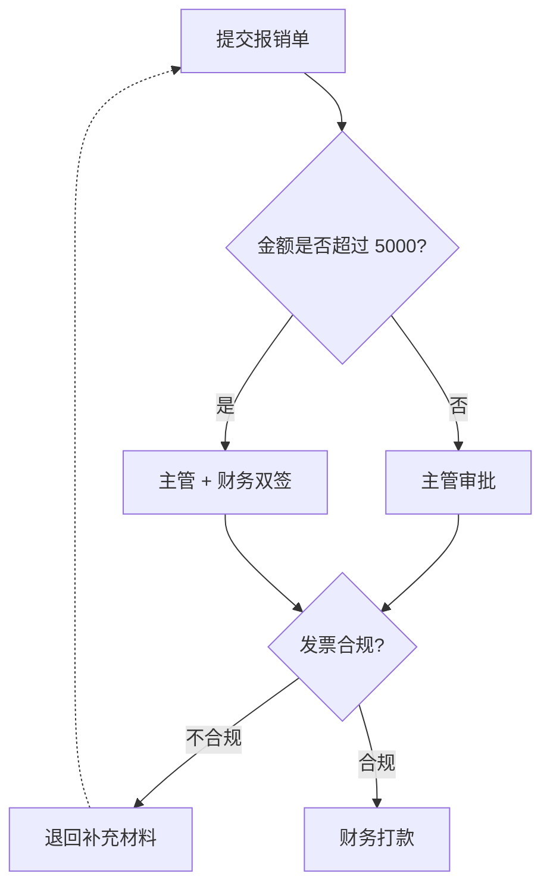

# flow.mjs 规格与语法手册

配套脚本：`../scripts/flow.mjs`。本文是写规格时该查的东西；用法与经验规则见 `../SKILL.md`。

## 一、CLI

```powershell
node flow.mjs render  <spec.json|spec.mmd|spec.md> [--out x.html] [--all] [--wrap N] [--debug]
node flow.mjs mermaid <spec.json> [--out x.mmd]      # 只导 Mermaid 源码；不带 --out 就打到 stdout
node flow.mjs check   <spec.json|spec.mmd|spec.md>   # 结构检查
node flow.mjs preview <流程图.html> [--out 对照预览.html]  # 并排 iframe 看手机/电脑两版
node flow.mjs refresh <目录>                         # 批量重渲染目录里所有规格，再重建清单与静态首页
node flow.mjs index   <目录>                         # 重建「全部流程图」清单（页面右上角抽屉用）
node flow.mjs sample  [--out sample.json]            # 写出一份完整示例规格
node flow.mjs help
```
配套工具（在 `scripts/` 下，都自己开临时标签页，不占用用户的标签页）：
- `probe.mjs <url> <探针.js> [--w 390 --h 844 --mobile --touch]`：在独立标签页里打开页面并求值一段 JS
- `devshot.mjs <url> [手机.png] [电脑.png]`：手机/电脑两张设备模拟截图 + 实测布局数据
- `cdp.mjs`：上面两个共用的小工具（`withOwnTab()` 建/关临时标签页）
- `serve.mjs [目录] [端口]`：局域网静态服务器，手机同 Wi-Fi 直接访问

依赖 `ws`：从 dsh 安装目录取（`$DSH_HOME/profiles/node_modules`），找不到时会明确报错。

- 输入扩展名决定解析方式：`.json` → JSON 规格；`.mmd`/`.mermaid` → Mermaid；`.md` → 抽取第一个 ` ```mermaid ` 代码块（没有就把全文当 Mermaid）。
- 不带 `--out` 时，产物写在**输入文件同目录**、同名 `.html`。**一次 render 输出两个版式**到同一个 HTML。
- `--all` 额外写 `<名>.mmd`、`<名>-竖版.svg`、`<名>-横版.svg`；`--svg x.svg` 时第二个是 `x-横版.svg`。
- `--wrap N` 覆盖横版的「每栏行数」（`0` = 不分栏，横版与竖版相同；`N≥1` = 固定每栏 N 行，`N=1` 表示一栏一个节点）。非整数/负数**直接报错**，不会静默归零。
- `--debug` 打印两版各自的栏数/行数与各栏成员，布局不合预期时先看它。
- 退出码：`0` 正常；`1` 是 `check` 发现结构问题；`2` 是参数或输入错误。输入诊断格式为 `flow: 文件:行:列: 说明`。
- 附带 `tools/devshot.mjs`：用 CDP 设备模拟给页面拍手机/电脑两张图，并打印 canvas/aside/footer 的实际高度与自动选中的版式（需调试浏览器在 9222）。
- 附带 `scripts/serve.mjs [目录] [端口]`：零依赖静态服务器，把产物目录暴露到局域网，手机同 Wi-Fi 直接访问（自动过滤 VPN/虚拟/169.254 地址，只推荐可用的那个）。手机端用法见 `../SKILL.md` 第四节。

## 二、JSON 规格字段

```jsonc
{
  "title": "示例：饮品店 · 每日开店到闭店",   // 画在图上，也用作导出文件名
  "subtitle": "素材驱动型 · 单人产能上限 2 期/天",
  "direction": "TD",                      // TD（纵向，默认）| LR（横向）
  "groups": [                             // 可选：背景分组带，成员必须是已定义的节点 id
    { "id": "g1", "label": "采集与下载（12:00–13:00）", "members": ["a", "b", "c"] }
  ],
  "nodes": [
    {
      "id": "e",                 // 必填，图内唯一（英文/数字/下划线/中文均可）
      "label": "人工过稿",        // 必填：节点标题，按 16 个全角字自动折行
      "kind": "milestone",       // 见下表，默认 task
      "status": "risk",          // 可选，见下表；不写就不显示状态点，也不进图例
      "time": "13:40–14:00",     // 可选：右上角时间窗
      "owner": "你",              // 可选：与 time 合并成一行小字显示在标题下方
      "detail": "事实核对 / 口径校准\n删敏感 / 补来源标注",  // 可选：详情面板正文，\n 换行
      "note": "这一步是版权与事实的唯一闸门，不可跳",         // 可选：详情面板里的醒目提示（橙色左边条）
      "color": "#e0a030"         // 可选：保留字段，当前作用于分组带
    }
  ],
  "edges": [
    { "from": "i", "to": "j", "label": "有", "style": "solid" },  // style: solid | dashed
    { "from": "d", "to": "e" }
  ]
}
```

### kind（决定形状与语义）

| kind | 形状 | 用在哪 |
|---|---|---|
| `task` | 圆角矩形 | 普通环节（默认） |
| `decision` | 菱形 | 真分支判断，标签会自动收窄折行 |
| `start` / `end` | 胶囊形 | 起点/终点 |
| `milestone` | 圆角矩形 + 粗左边框 | 关键检查点（过稿、验收） |
| `risk` | 虚线边框 + 彩色左边条 | 风险/加更/临时插单 |
| `circle` | — | **仅 Mermaid 输入**用；按入出度自动补全为 start 或 end |

### status（决定状态点颜色与图例）

| status | 含义 | 颜色 |
|---|---|---|
| `done` | 已完成 | 绿 |
| `doing` | 进行中 | 蓝 |
| `todo` | 待开始 | 灰 |
| `risk` | 需人工把关 | 红 |
| `hold` | 阻塞 / 等素材 | 橙 |

图例只列出**规格里实际出现过**的状态；点图例可把该状态整体压暗做筛选。

## 三、Mermaid 子集（支持的语法）



| 语法 | 支持 |
|---|---|
| `flowchart TD / TB / LR`、`graph` | ✅（`BT`/`RL` 归一到 TD/LR） |
| `A[文本]` 矩形、`A(文本)` 圆角、`A{判断}` 菱形、`A((圆))` | ✅ |
| `A[[子程序]]`、`A{{六边形}}` | ⚠️ 解析但按普通 `task` 渲染 |
| `-->`、`-.->`（虚线）、`==>`、`---`、`--x`、`--o` | ✅（除 `-.->` 外一律实线） |
| 边标签 `-->|标签|` | ✅ |
| 链式 `A --> B --> C --> D` | ✅ |
| `subgraph 名称` … `end` | ✅ 变成分组带 |
| `%%` 注释 | ✅ 忽略 |
| `classDef` / `class` / `style` / `linkStyle` / `click` / `direction` / `accTitle` / `accDescr` | ✅ 忽略（对渲染语义无影响；命令行会提示「已忽略…」，从别处粘来的片段可以直接画） |
| `A & B --> C`（多节点连接） | ❌ 不支持 |

要点：
- Mermaid 只能表达**结构**（节点、连线、分组）。时间窗、负责人、状态、说明这些**只能在 JSON 里给**——需要这些就别用 Mermaid 输入。
- 标签中的分号、引号和括号按形状/引号边界扫描；未闭合形状、未配对的 `subgraph/end`、不支持的语法会明确报错并标出文件、行、列。
- 节点/分组标签含 `[ ] { } ( ) | "` 时，导出的 Mermaid 用双引号包起来（解析侧会还原）；**边标签里的 `|` 会换成视觉等价的 `∣`（U+2223）**，因为 `|…|` 语法装不下竖线。
- 图片里带 `"` 的标签没问题（`E(标注"真题改编")` 实测正确保留）。
- 从 JSON 导出的 `.mmd` 再解析回来是幂等的：`{}` 判断、`-.->` 虚线、`|标签|`、`subgraph` 都能保住（已实测）。

## 四、布局与视觉规则

1. 分层：按最长路径定层（回边不计入分层）。
2. 同层次序：入边邻居重心排序，迭代 3 轮。
3. 普通节点尺寸：按全角字宽算，宽 150–420px；高 `48 + 行高 + (负责人?18:0) + 18`；宽度还要容得下左上图标 + 右上时间药丸。
4. **判断（菱形）节点自动定尺**：按内接矩形条件 `a/W + b/H ≤ 1/2`（a、b 为文字块半宽半高）取 `H = 2.6×文字块高`、`W ≈ 1.9×文字宽`（多行时 2.3×），所以菱形不会把文字压出边界。
5. 层间距 **84px**、同层间距 **34px**；列间距（分栏时）118px。
6. 回边（含环）与同层边：走**本列右侧**正交旁路，拐角做 9px 圆角（`orthoPath`），不会横穿节点。
6b. **分组带上内边距 54px**：标题药丸画在带顶 +10~+33，第一个节点顶边在 +54 → 约 21px 呼吸感。早期只留 34px（药丸底边离节点仅 1px），看着"标题贴着流程步骤"。
6c. **标题「药丸 + N 步」靠带内左上角**：`lx = b.x + 13`（固定左内边距）。2026-10 之前是「药丸 + 计数」整组水平居中，带一宽标题就被拱到中间，长标题也容易被挤；改成左对齐后带宽变化时标题位置稳定，读起来像泳道图表头。宽度公式里的文字宽用 `units()*12.4`（药丸）/`*12`（计数），与渲染保持一致。
6d. **分组带宽度 = max(成员包围盒 + 40, 26 + 药丸宽 + 8 + 计数宽)**：否则长标题（如 `阶段三｜材料与门槛判定（2027.9–2028.7）`）会探出带外。已按 12 个分组逐一核对：全部在框内且不越界。
7. **分栏（wrap）**：参数是「每栏行数」`R`，栏数 `C = ceil(层数 / R)`。层 `i` 落在第 `floor(i/R)` 栏、第 `i%R` 行；**每栏都从上往下读**（不做蛇形，否则箭头方向会上下交替）。`R` 由 `pickWrapRows` 在 1..L 之间选，评分是 `|log((W/H) / 目标宽高比)|`，目标默认 1.6。
8. **跨栏连线**：源/目标所在行都只有 1 个节点时走**列间空隙**（源右侧 → 空隙 → 目标左侧，路径最短）；否则走**底部走廊**（源底部 → 走廊 → 空隙 → 目标侧面），保证不横穿节点。
9. `direction: "LR"` 的实现是**先在 TD 空间排版再整体转置**，所以节点宽高会互换。注意长链用 LR 会得到极扁的 4:1 长条，fit 后字很小——**链式流程要横向请用分栏，不要用 LR**。
10. **分组带跨栏会自动切段**：同一分组落在不同栏时，按栏各画一个带，第二个起标「（续）」，避免一个矩形把不相干的节点圈进去。
11. 画布尺寸 = 内容尺寸 + 左右各 40 内边距 + 右侧 120 预留（给旁路走线）+ 标题区。

### 视觉构成（美化后的设计要素）

| 元素 | 设计 |
|---|---|
| 画布 | 点阵底纹（`#grid` 26px 间距的圆点），作为"纸面"质感，不随缩放移动 |
| 标题块 | 左侧 4.5px 主题色竖条 + 21px 标题 + 12.5px 副标题 |
| 节点 | 圆角 12 卡片 + 柔和投影（`#nShadow`）+ 左侧 3.5px 状态色竖条；起点/终点为胶囊 |
| 状态色 | 竖条、图标圆环、详情面板徽标统一取色：done 绿 / doing 蓝 / todo 灰 / risk 红 / hold 橙 |
| 类型图标 | 左上圆形徽标内一个字形：起点 `▶`、终点 `■`、检查点 `✓`、风险 `!`；普通环节无图标，判断节点靠菱形表意。**角标按形状自适应摆位**（`fitBadge()`）：圆角卡片/胶囊要把圆心离边界留够 4.5px（圆环描边 0.6 + 节点描边最多 1.3 都在往外长），胶囊会因此比卡片多右移约 6px，菱形固定在正中 |
| 时间窗 | 右上角胶囊药丸（普通节点）；判断节点没有图标行，时间并入标题下方小字。药丸本身是"高 21 的胶囊"，**同样按 `fitPill()` 内推**：右边距固定 12 对圆角卡片够（余量 8.5px），但胶囊的右上角是弧，硬贴右边会顶出 -3.6px |
| 连线 | 1.7px，贝塞尔控制点 `max(26, 0.38×Δy)`；虚线边 `5 5`；箭头为 12×12 三角 marker |
| 边标签 | 圆角 10.5 胶囊 + 描边，不会和线糊在一起 |
| 分组带 | 6% 透明度填充 + 34% 描边 + 圆角 16；左上角是**标签胶囊 + 带外的「N 步」计数**，二者作为一组靠**左上**（左内边距 13，2026-10 起不再居中）；带比节点列宽时**左右对称外扩**（不往右单边长），这样所有带的中心线对齐、节点列永远居中 |
| 交互态 | 选中：2.4px 描边 + 蓝色辉光；搜索命中：蓝色 `--hit` 描边；筛选/淡出：12% 透明度 + 灰度 |

### 主题与可读性（浅色为什么这么配色）

明暗两套是**同构**配色，只是亮度方向相反。实测 WCAG 对比度（越低越"糊"）：

| 部位 | 深色 | 浅色（当前） | 缩小自动高对比 |
|---|---|---|---|
| 节点底 vs 画布 | 1.25:1（相对亮度差 65%） | 1.34:1（34%） | 1.40:1 |
| 节点描边 vs 画布 | 2.34:1 | 3.29:1 | 4.22:1 |
| 连线 vs 画布 | 6.85:1 | 3.71:1 | 4.28:1 |

关键结论：**浅色主题的短板是「笔迹」而不是「底色」**。两个主题的「方块底 vs 背景」WCAG 比值几乎一样（1.19 / 1.25），但在接近白色的区间做区分时，相对亮度差只有深色的 1/4（韦伯定律），所以一缩小就糊成一片；真正先消失的是**连线和箭头**（浅色 2.67:1 vs 深色 6.85:1）。因此浅色画布 `#f1e9da→#e8dbc4`，节点描边 `#a8946f→#8a7448`（2.44→3.29）、连线 `#9c8d7c→#7d6c52`（2.67→3.71）、次级连线 `#e0d5c0→#b8a37c`。想把整页调回浅奶油底，只改 `svg[data-theme='light']` 与 `html[data-theme='light']` 两组变量即可（首页在 `serve.mjs`，同一组值）。**加多少要克制**：第一版缩小时直接把描边压到 5.57:1、画布压到 `#e0cfae`，用户反馈「拉远以后变化太大」，所以改成只再加一档（描边 4.22:1、画布 `#e4d7bb`）——缩小是"远看结构"，不是换主题。

**缩小时自动再加深一档**（阈值 `view.K*15 < 8.5`，即 15px 正文被缩到不足 8.5 屏幕像素时）：

- `svg.zoomed-out`：隐藏时间药丸、`t-meta` 小字、点阵底纹；节点描边 1.5→2.6、连线 1.8→2.2、边标签底色块去掉；
- `svg[data-theme='light'].zoomed-out`：浅色描边再压到 `#75603c`、连线 `#6f6049`（笔迹 4.22:1 / 4.28:1）；
- `html[data-theme='light'] body:has(svg.zoomed-out)`：画布压到 `#e4d7bb`，`#canvas` 与 `html,body` 带 `.22s` 过渡，切档不闪；
- 深色主题不需要这一档（连线本来就 6.85:1）；手机竖版默认是宽度自适应，通常不会触发，细节不丢。

为什么用 `:has()`：`.zoomed-out` 类挂在 `<svg>` 上，而画布是它的**祖先**节点，只能反向选择；Chromium 105+ / Edge 105+ 支持（本项目本来就只面向 Edge/Chrome）。


**页面 UI 的对比度（`assets/app.css`，由 `tools/tests/contrast.mjs` 复算）**

| 令牌 | 深色 | 浅色 | 说明 |
|---|---|---|---|
| `--muted` | #9aa5b8（5.74:1） | #645b4b（4.54:1） | 次要文字；浅色下必须比原来深 |
| `--accent-text` | = `--accent`（5.81:1） | #884c29（4.58:1） | **文字专用**；圆点/描边继续用原色 `--accent` |
| `--ok-text` / `--warn-text` / `--risk-text` | = 原色 | #256843 / #795411 / #a43534 | 状态 chip 的文字色 |
| `--hit` | #4a9dff（5.13:1） | #1a5fb0（4.31:1，非文本） | 搜索命中；**必须在页面作用域再定义一份**，SVG 里那份 `<aside>` 拿不到 |

**SVG 内的分组带标题**：深色沿用组色调色板（亮色在深底上清楚）；**浅色必须压深**——
`svg[data-theme='light'] .band-label, .band-count{fill:color-mix(in srgb, var(--c) 41%, #241f19)}`
（渲染时把组色同时输出成 `--c`）。原色对「7.5% 组色浅底」只有 1.31–2.08:1，混深后 4.53–5.72:1 全部达标。

**可访问性**：`.node` 运行时加 `tabindex="0"` `role="button"` `aria-label`（Tab 可达、Enter/空格选中），导出 SVG 时会清掉这三个属性；
`#flows-drawer` 是 `role="dialog" aria-modal="true"`，关闭态用 `inert` 移出 Tab 序；全站 `:focus-visible` 焦点环用 `--accent-text`。


## 五、产物里有什么

`.html` 单文件页面，内含**两个版式**（`<svg data-variant>`）与一份布局无关的 Mermaid 源码：

| 版式 | 布局 | 目标设备 |
|---|---|---|
| `portrait` 竖版 | 单列纵向（`wrap: 0`） | 手机：宽度撑满 + 竖向滚动 |
| `landscape` 横版 | 长流程自动分栏（`wrap: -1`，目标比 1.6） | 电脑：一屏放下 |

自动选版：`宽<760px 或 宽高比<1.08 → 竖版`，否则横版；用户手动切过之后不再自动跟随（`manual` 标志），窗口缩放只重新适配。

| 区域 | 能力 |
|---|---|
| 顶栏 | 品牌点 + 标题、搜索框（分档命中，见下）、**「全部流程图」按钮**、状态图例胶囊（点击筛选） |
| 画布 | 点阵底纹；**鼠标**：滚轮缩放、拖拽平移、双击空白适配；**触屏**：单指平移、双指捏合缩放、轻点选中（`touch-action:none`） |
| 右栏 | 概览 / 搜索结果清单 / 节点详情三态；手机上默认收起的底部抽屉（`body.panel-open` 控制） |
| 底栏 | 竖版/横版切换、概览/详情（仅手机显示）、缩放分段控件、适配、导出 SVG/PNG、明/暗、Mermaid 面板 |
| 键盘 | `+`/`-` 缩放、`0` 适配、`Esc` 取消选中 |

**搜索分档**：`标题/id/时间/负责人` 命中 → `.is-hit`（蓝边）；只有 `说明/备注` 命中 → `.is-hit-soft`（橙色虚线边）。计数写 `N 个匹配（M 个只在说明/备注里）`，右栏同时列出 `.hit-row` 命中清单（带命中字段名与上下文片段，`mark` 高亮），点击定位。

**「全部流程图」抽屉**：右上 `#flows-toggle` → `#flows-drawer`（+ `#drawer-scrim`）。数据来自页面内嵌的 `data.flows` 快照，HTTP 打开时再 `fetch('流程索引.json')` 刷新。清单由 `scanFlows(dir)` 生成，靠页面上的 `data-flow-viz="1"` 标记 + `meta[name=flow-title|flow-stats]` 识别与取数，`【`/`.` 开头的文件会被跳过。**顺序固定按文件名 `localeCompare(zh)`**，快照与清单一致；当前页渲染成 `<div class="flow-row cur">` 而不是链接。

**主题（三档 + 后改优先）**：`flowviz-theme`（总设置，首页写）、`flowviz-theme:<文件名>`（单张，页面明暗键写）、`flowviz-lock:<文件名>`（锁定）。值都是 JSON `{mode, ts}`（旧版纯字符串仍兼容为 `ts:0`）。生效顺序：锁定 → 单张与总设置比 `ts` 取新 → 都没有则跟随系统。`<head>` 里有一段等价的引导脚本在首帧前应用，避免闪色；页面 JS 里 `effective()` 是同一套规则。锁定态点明暗键会被拦下并弹 `#toast` 提示。首页卡片底部会按本机 localStorage 显示「🔒 已锁定 X」或「单独设为 X」徽标。

**浅色 = 米色千禧年**：页面 `#f2ebdd`/`#fdfaf3`/`#33302a`/`#bf6b3a`；SVG 侧另有 `--n-task:#fffdf7`、`--grid:#e6dcc8`，选中辉光换成暖色 `#selGlowWarm-<vid>`。

**首页（文件列表）**由 `serve.mjs` 动态生成（不是磁盘文件），自适应三档：

| 宽度 | 布局 |
|---|---|
| ≤620px | 单列卡片、缩略图 150px |
| ~820px | 2 列 |
| ≥1440px | 4 列、缩略图 190px |

每张卡片：**缩略图**（优先 `<stem>-横版.svg`，回退竖版，`loading="lazy"`）+ 标题 + `N 环节 · N 连接 · N 分组 · 横版 WxH · 竖版 WxH` + 徽标（`手机上点这个` / `电脑用 · 手机上别点`）。元信息优先读同目录的 `流程索引.json`，没有就解析 HTML 头部的 `meta[name=flow-title|flow-stats]`。矢量图 / `.mmd` / 清单收在底部「其它文件」的胶囊列表里。`⬆︎ 返回上级目录` **只在子目录里出现**（在根目录没有意义，会指向 `_out`）。

顶部还有「显示设置」（跟随系统 / 始终深色 / 始终浅色）与人话版说明（两种搜索命中、手势、电脑用文件提醒）。

**两版状态同步**：选中、搜索命中、状态筛选、主题切换都会同时作用到两个 SVG，切换版式不会丢失当前关注点；导出按**当前版式**出文件，文件名带 `-竖版` / `-横版`。

**缩放的坐标系（重要）**：SVG 的 `viewBox` 自身会按 `meet` 缩放一次，所以客户端逐版在**元素像素空间**维护 `view{K,TX,TY}`，`paint()` 再反解成 user 单位的 `transform`。因此显示百分比是**相对于"整幅适配"**的：`100%` = 恰好放下整幅，长流程在手机上打开时会显示 300%+。

初始视野规则（逐版独立，`initial()`）：

1. `?zoom=N` 存在时按 `N × 整幅适配` 固定（截图/检查小比例可读性用）；
2. 否则：**横而扁**的图（`宽/视口宽 ≤ 整幅适配×1.8`，或内容宽高比 > 1.2）直接整幅适配；
3. **竖版长流程**（最常见）给一个上限：`K = min(铺满宽度, 整幅适配 × fitcap)`，`fitcap` 默认 **1.45**、可用 `?fitcap=2.2` 临时改。为什么封顶：铺满宽度时手机上只能看到四五个环节（实测 294% 只见 4/13 个），而长流程打开时想先看清整体走向。1.45 时 13 个环节能一屏看到 9 个，笔迹落在"简化"区间（标题仍可读、时间药丸与负责人小字自动隐藏）；
4. Y 方向：一屏装得下就垂直居中，装不下从顶部开始；
5. **记住上次手动缩放**：`flowviz-zoom:<文件名>:<版式>` 存 `{k,ts}`，`zoomAt()`（滚轮/捏合/±按钮）与 `fitAll()`（适配/双击空白）都会写；下次打开恢复该档位（只恢复缩放比例、不恢复平移，避免停在某个角落）。`适配` 按钮始终回到整幅（100%）。

**移动端 CSS**：`≤960px` 主区改为纵向堆叠；`≤600px` 搜索框独占一行、图例换行、页脚按钮只留图标，**概览/详情变成 `position:fixed` 的覆盖式底部抽屉**（`max-height:58vh`，圆角 + 阴影，`z-index:15`；抽屉 `#flows-drawer` 是 20）。因为脱离 flex 流，开合面板不会改变画布尺寸。

**画布底纹**：`<rect class="canvas-grid">` 是 `#vp` 的第一个子元素、范围 `x=-W y=-H w=3W h=3H`——跟着缩放平移走且不会在视野内露出边界。

**标题块**：HTML 版 `renderSvg(..., head=false)` 不画，导出的 `.svg` 用 `head=true` 画。页面顶栏已经承担标题展示。

`.svg` / `.png` 导出的图里包含标题、副标题与点阵底纹，可单独打开或直接贴进文档。

## 六、常见报错与处理

| 现象 | 原因 / 处理 |
|---|---|
| `节点 id 重复：x` | JSON 里 id 重了，改掉 |
| `连线起点不存在：x` | 边引用了未定义的节点，补节点或改边 |
| `未知 status：x` | status 只接受 done/doing/todo/risk/hold |
| `flow: 参数 --out 缺少取值` | 布尔参数只有 `--all`/`--debug`/`--help`，其余都要值 |
| `节点不可达` / `孤立节点` | `check` 的提示，通常是真的漏了边；确认无误也可照常渲染 |
| 图太挤 / 交叉多 | 缩短 label（折行变少）、把长链拆成两张图、换 `direction` |
| 打开 html 是空白 | 看浏览器控制台；脚本无外部依赖，通常是文件没写全（检查文件大小） |
| 截图时 `ERR_FILE_NOT_FOUND` | `file://` 的中文路径百分号编码写错了。用 `[System.Uri]::new((Resolve-Path ...).Path).AbsoluteUri` 生成，别手写 |
| `SyntaxError: Invalid or unexpected token` 指向第 1 行 | 文件被写入了 UTF-8 BOM，破坏了 shebang。**不要用 PowerShell 的 `Set-Content` 改这个脚本**（会加 BOM）；改用编辑工具，或用 `[System.IO.File]::WriteAllText($f,$t,(New-Object System.Text.UTF8Encoding($false)))` |
| 缩放百分比和实际大小对不上 | 忘了 `viewBox` 自己会做一次 `meet` 缩放。所有缩放/平移都要在元素像素空间算（见第五节的坐标系说明） |
| **概览面板空白 / aside 只有 20 多 px** | 客户端初始化中途抛异常了。两版并存时，`renderSvg` 里所有 id（`vp`、`nShadow`、`selGlow`、`grid`、`arrow*`）都必须带 `-${vid}` 后缀，否则 `getElementById('vp-landscape')` 拿到 null 就会中断整个 init |
| 竖版被排成极扁的横条 | `wrap` 参数语义是「每栏行数」：不换行要传 `0`（内部取 `R = 层数`），传 `1` 会变成每层一栏 |
| 怀疑页面报错 | 先用 `Runtime.exceptionThrown` 抓异常，但**必须先 `Page.navigate` 到 `about:blank` 再进目标页** —— `Runtime.enable` 会把上一个文档的异常一起回放，容易把旧错算到新页面上 |
